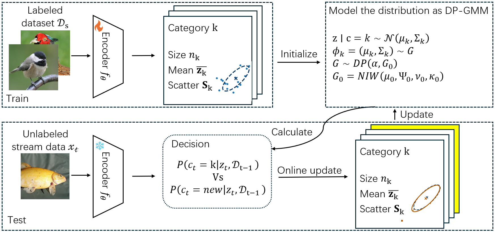

# DP-BOA

[Project Page](https://algpy.github.io/DP-BOA-pages/) | [Paper](https://arxiv.org/abs/2607.13504)

Implementation of **Dirichlet-Process Birth-or-Assign for On-the-Fly
Category Discovery**, including the full-covariance and Frequent Directions (FD) variants.



## Installation

Run the following commands from the repository root:

```bash
conda env create -f environment.yml
conda activate dp-boa
```

## Quick start

1. Download the [DINO ViT-B/16 weights](https://dl.fbaipublicfiles.com/dino/dino_vitbase16_pretrain/dino_vitbase16_pretrain.pth)
   to `pretrained/dino_vitbase16_pretrain.pth`.
2. Set dataset paths in [config.py](config.py) or through environment variables.
   For [CUB-200-2011](https://www.vision.caltech.edu/datasets/cub_200_2011/),
   place the extracted `CUB_200_2011/` directory under `CUB_ROOT`.
3. Run pretraining, followed by standard or FD inference:

```bash
export CUB_ROOT=/path/to/cub
export CUDA_VISIBLE_DEVICES=0

# Supervised pretraining
bash scripts/run.sh pretrain cub

# Standard inference
bash scripts/run.sh full cub

# FD inference (alternative)
bash scripts/run.sh fd cub
```

For other dataset presets and options, run `bash scripts/run.sh --help`.

## License

[Apache-2.0](LICENSE). See [third-party notices](THIRD_PARTY_NOTICES.md) for upstream attribution.

## Citation

```bibtex
@inproceedings{gu2026dp,
  title={DP-BOA: Dirichlet-Process Birth-or-Assign for On-the-Fly Category Discovery},
  author={Gu, Peiyan and Teng, Zixin and He, Xuming},
  booktitle={European Conference on Computer Vision},
  pages={261--280},
  year={2026},
  organization={Springer}
}
```
